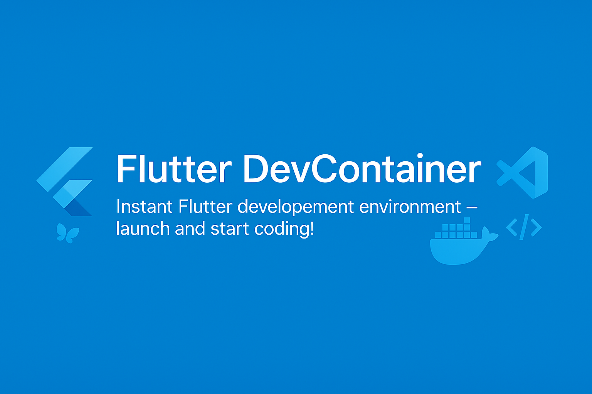

# DevContainer Templates

**A collection of Dev Container Templates**

This repository provides a Flutter development environment for VS Code Dev Containers and GitHub Codespaces, using the official Flutter SDK on Debian Bookworm. Both Intel/AMD (`amd64`) and Apple Silicon (`arm64`) hosts are supported.



## Available Templates

| Category | Template | Template reference | Description | Documentation |
|----------|----------|-------|-------------|---------------|
| Flutter Development | Flutter | `ghcr.io/techiro/devcontainer-template/flutter:2` | Flutter 3.47.7, bundled Dart SDK, Chromium and Linux build tools | [src/flutter/README.md](src/flutter/README.md) |

## Usage

1. Install and start a Docker-compatible runtime (Docker Desktop, or Docker CLI with Colima on macOS).
2. Install the [Dev Containers](https://marketplace.visualstudio.com/items?itemName=ms-vscode-remote.remote-containers) extension in VS Code.
3. Clone this repository and open it in VS Code.
4. Run **Dev Containers: Reopen in Container**. The repository's own configuration builds the same Flutter environment as the template.

To add the published template to an existing project, or to debug a new Flutter app, follow the [Flutter setup guide](src/flutter/README.md).

The registry reference is an **OCI Dev Container Template**, not a runnable Docker image. The template builds its included Dockerfile; it does not depend on a separately published Flutter image.

## Contributing

Run the same smoke test as CI from a host with Docker running:

```sh
npx --yes --package=@devcontainers/cli@0.89.0 -- bash test/flutter-smoke.sh
```

This applies the template's default options in a temporary workspace, checks empty and existing projects, runs analyzer and VM/Chromium tests, and builds Web and Linux apps. It removes its test container on exit and leaves the temporary workspace path in the log for inspection.

1. Fork the repository
2. Create a new branch
3. Make your changes
4. Submit a pull request

## License

This project is licensed under the MIT License - see the [LICENSE](LICENSE) file for details.
