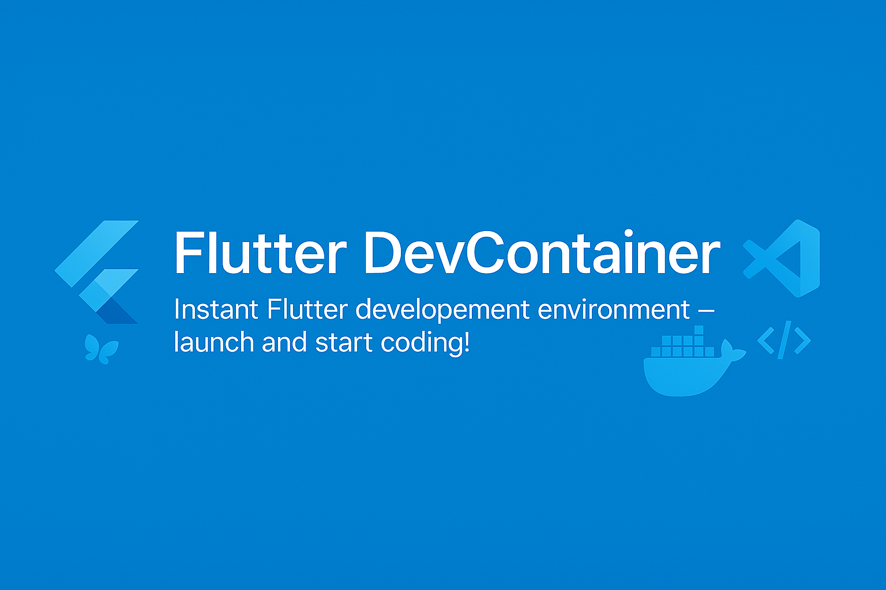

# DevContainer Templates

**A collection of Dev Container Templates**

This repository provides a Flutter development environment for VS Code Dev Containers and GitHub Codespaces, using the official Flutter SDK on Debian Bookworm. Both Intel/AMD (`amd64`) and Apple Silicon (`arm64`) hosts are supported.



## Available Templates

| Category | Template | Template reference | Description | Documentation |
|----------|----------|-------|-------------|---------------|
| Flutter Development | Flutter | `ghcr.io/techiro/devcontainer-template/flutter:2` | Flutter 3.47.8, bundled Dart SDK, Chromium and Linux build tools | [src/flutter/README.md](src/flutter/README.md) |

## Usage

1. Install and start a Docker-compatible runtime (Docker Desktop, or Docker CLI with Colima on macOS).
2. Install the [Dev Containers](https://marketplace.visualstudio.com/items?itemName=ms-vscode-remote.remote-containers) extension in VS Code.
3. Clone this repository and open it in VS Code.
4. Run **Dev Containers: Reopen in Container**. The repository's own configuration builds the same Flutter environment as the template.

To add the published template to an existing project, or to debug a new Flutter app, follow the [Flutter setup guide](src/flutter/README.md).

The registry reference is an **OCI Dev Container Template**, not a runnable Docker image. The template builds its included Dockerfile; it does not depend on a separately published Flutter image.

## Contributing

### Maintain the template with Codex Cloud

Codex Cloud can edit this template repository and run its lightweight checks
without VS Code, Docker, Chromium, or the Flutter SDK. GitHub Actions builds and
tests the actual development container. This maintenance environment is not a
Flutter application development environment.

| Environment | Responsibility |
|---|---|
| Codex Cloud | Review and edit SDK selections, Dockerfile, configuration, documentation, and tests; run lightweight checks; prepare a pull request and inspect CI results |
| GitHub Actions | Validate amd64 and arm64 containers, Flutter analyzer and VM/Chromium tests, Web/Linux builds, SDK advisories, CLI dependencies, and image OS packages |
| VS Code Dev Containers or Codespaces | Manually verify changes to extensions, F5/breakpoints, workspace paths, or port forwarding and browser preview |

#### Prepare the cloud environment

Use the current [Codex Cloud environment setup](https://learn.chatgpt.com/docs/environments/cloud-environments),
select `techiro/devcontainer-template`, and keep **Who can use** set to **Only me**.
Ask setup to prepare a maintenance-only environment with Git, Python 3, and Bash;
do not install the Flutter toolchain or start the repository's devcontainer.
For this configuration, name the published environment
`devcontainer-template-maintenance`. Restrict network access to `github.com` and
`api.github.com`, with full public internet access and the Package managers
presets disabled. Add no secrets or Start skill.
Use the following commands as the Install script, from the repository root:

```sh
set -eu
git --version
python3 --version
bash --version
python3 -m unittest discover -s test -p 'test_*.py' -v
bash -n test/flutter-smoke.sh
git diff --check
```

These checks need no third-party Python packages, credentials, or running services.
No Start skill is needed. Publish the prepared environment, then run the same
checks in a **new cloud task**; setup success alone does not verify task access.
Repeat the checks after checking out or updating a branch. Reconfigure and
republish when the required tools change, and verify with a new task.

Use the connected GitHub integration for repository access. Before relying on
unattended maintenance, verify in a cloud task that it can create a branch/PR
and read that PR's checks, workflow jobs, and failure logs. Local GitHub CLI
credentials are not automatically available in Cloud. If using authenticated
`gh` instead, configure it explicitly in the environment without committing or
printing credentials. Allow only the GitHub endpoints that this workflow needs;
the local checks above do not require public internet access. Do not treat a
network allowlist as authentication or permission to publish.

#### Work through a pull request

1. Read this README and the [Flutter guide](src/flutter/README.md), check the
   current branch and working tree, and create a topic branch from current `main`.
2. Make a focused change and run the lightweight checks above. Add or update
   relevant regression tests when changing behavior.
3. Open a PR targeting `main`. Inspect the **current PR head commit's** workflow
   results for both `ubuntu-latest` and `ubuntu-24.04-arm`. Read failing job logs,
   fix the cause, push the correction, and check the new commit's results.
4. Inspect the `security-*` artifacts when assessing SDK or image updates.
   Preserve the existing security gates and Chromium sandbox requirements;
   do not disable them to obtain a green check. Passing CI is not a claim of
   zero vulnerabilities; see the [release policy](src/flutter/README.md#ci-reports-and-release-policy).
5. Report lightweight checks, container/architecture CI results, security findings,
   and IDE checks separately. Say explicitly when IDE operation was not tested.

The PR workflow validates changes without publishing. Confirm that `deploy` is
**skipped** for the PR run. A push to `main` or a manual workflow dispatch on
`main` can publish to GHCR after validation and environment protection checks.
Maintenance tasks must stop at the reviewable PR unless merging/publication is
separately requested; do not enable auto-merge or dispatch a release to test setup.

For the first acceptance run, use a documentation-only PR. Confirm repository
read/write access, all existing Python tests, both architecture validation jobs,
the skipped deploy job, and access to job logs. Record any unverified cloud
capability rather than substituting a local result. No claim about VS Code
debugging or interactive preview follows from a successful CLI/CI run.

### Validate the full container locally

Run the same smoke test as CI from a host with Docker running:

```sh
npx --yes --package=@devcontainers/cli@0.89.0 -- bash test/flutter-smoke.sh
```

This applies the template's default options in a temporary workspace, checks empty and existing projects, runs analyzer and VM/Chromium tests, and builds Web and Linux apps. It removes its test container on exit and leaves the temporary workspace path in the log for inspection.

1. Fork the repository
2. Create a new branch
3. Make your changes
4. Submit a pull request

## License

This project is licensed under the MIT License - see the [LICENSE](LICENSE) file for details.
